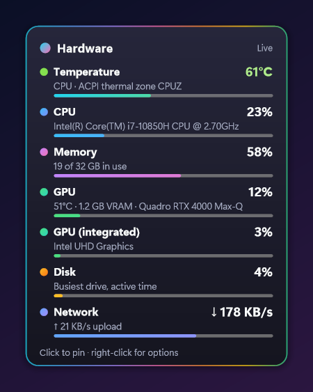
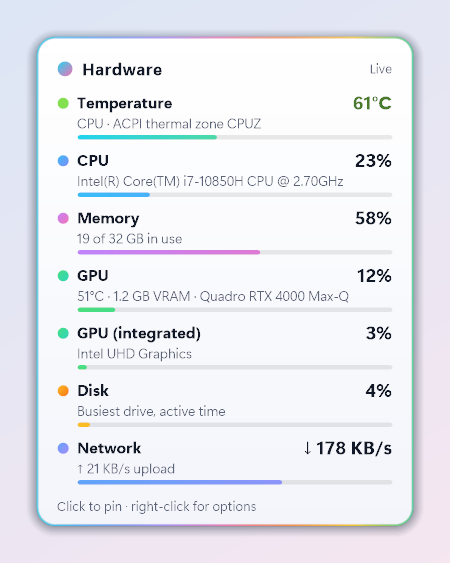

# HW Widget

A small, colorful hardware pill for the Windows taskbar, the GNOME top bar and the macOS menu bar.
It shows the **temperature** plus the 3 metrics that matter most: **CPU**, **memory** and **GPU** (or disk when there is no GPU).
Open it for details: GPU temperature and memory, disk activity and network speed.


| Windows card (dark) | Windows card (light) | GNOME card |
| --- | --- | --- |
|  |  |  |

## What it shows

| Cell | Source (no admin or root rights needed, except the opt-in Windows CPU temperature helper) | Turns amber / red at |
| --- | --- | --- |
| **TEMP** | CPU package temperature; GPU temperature (labelled `GPU°`) when the CPU has no readable sensor | 80 / 90 °C |
| **CPU** | Total processor load | 75 / 90 % |
| **RAM** | Memory in use | 80 / 90 % |
| **GPU** | Busiest graphics adapter; **DISK** (busiest drive's active time) when there is no GPU | 85 / 95 % (disk 80 / 95 %) |

Temperatures are in **°C** by default; switch to °F in the menu.
An unknown value shows a dim dash instead of a guess.

## Install

### Windows 10 and 11

1. Download or clone this repository.

2. Double-click `Install HW Widget (Windows).cmd`.

It compiles the widget with the C# compiler built into Windows (no SDK, no downloads, no admin rights), runs its self-test, adds it to startup and launches it.
The pill sits on the taskbar left of the tray. Hover for the details card, click to pin it, right-click for settings.

Remove it with:

```powershell
powershell -ExecutionPolicy Bypass -File windows\uninstall.ps1
```

Sensors: Performance counters (CPU, memory, disk), the Windows graphics kernel (GPU load and temperature, as Task Manager shows them), NVIDIA NVML as a fallback, ACPI thermal zones for the CPU temperature, and [LibreHardwareMonitor](https://github.com/LibreHardwareMonitor/LibreHardwareMonitor) when it is running.

#### No CPU temperature? Enable the helper (1 admin prompt)

Some laptops, for example Intel Core Ultra (Lunar Lake) machines, show a dash for TEMP. Their only ACPI zone is a fixed placeholder, and the real sensors (Intel Dynamic Tuning, `root\wmi:EsifDeviceInformation`) can only be read by an admin.

To fix it, right-click the pill and choose **Enable CPU temperature (admin)**. You can also run this:

```powershell
powershell -ExecutionPolicy Bypass -File windows\install.ps1 -EnableCpuTemp
```

After 1 UAC prompt, this does 3 things:

1. It copies the widget to `%ProgramFiles%\HWWidget\HWWidgetSensor.exe`, a folder only admins can write to.
2. It registers the `HW Widget CPU temperature helper` task, which runs as SYSTEM at boot.
3. Every 2 seconds the task writes the hottest live reading to `%ProgramData%\HWWidget\cpu-temp.txt`. Users can read that folder but not write to it.

The widget itself still runs without admin rights. It ignores readings older than 15 seconds.

Turn the helper off from the same menu, which then reads **Remove CPU temperature helper (admin)**. `uninstall.ps1` also removes it.
It uses under 1 % of 1 core and about 45 MB of memory, and hides itself while a full-screen app is in front.

### Linux (GNOME Shell 45–49)

```bash
sh linux/install.sh
```

On Wayland, log out and back in once if the script asks you to.
Sensors: `/proc` for CPU, memory, disk and network, `hwmon` and thermal zones for temperatures (Intel `coretemp`, AMD `k10temp`, ARM `cpu-thermal`), `nvidia-smi` for NVIDIA GPUs and `amdgpu` sysfs for AMD GPUs.
Settings are saved in `~/.config/hwwidget/settings.json`.

### macOS 13 or later

```bash
./macos/install.sh
```

It needs the Command Line Tools (`xcode-select --install`), builds `HW Widget.app` into `~/Applications`, starts it and adds it to login items.
Sensors: Mach host statistics (CPU, memory), IOKit (GPU load and memory, disk activity), the Apple Silicon thermal sensors or the Intel SMC for temperatures, and macOS's thermal state as a fallback.

## Develop and test

| Platform | Command | What it checks |
| --- | --- | --- |
| Windows | `windows\build.ps1`, then `windows\bin\HWWidget.exe --selftest out.txt` | 23 sensor, helper, layout and formatting checks |
| Windows | `HWWidget.exe --render <dir>` / `--probe <secs> <csv>` | PNG renders of every state / live sensor log |
| Linux | `sh linux/tests/run-docker.sh` | 44 parser, sensor-tree and model checks in Docker, plus PNG renders in `linux/tests/out` |
| macOS | `sh macos/tests/run-docker.sh` | 35 model and parser checks of the shared core, on Linux in Docker |
| macOS | `HWWidget --self-test`, `--probe 10`, `--render <dir>` | The same checks, a live sensor log and PNG renders, on a Mac |

CI runs all 3 platforms on pull requests and on manual runs, each only when its folder changes.

## Status

| Platform | Verified |
| --- | --- |
| Windows 11 | Running daily on a real laptop (Intel i7, NVIDIA Quadro): readings match Task Manager and `nvidia-smi` |
| Linux / GNOME | Sensors, model and drawing tested in Docker; not yet run inside a live GNOME Shell session |
| macOS | Builds, self-test, live probe and renders pass on GitHub's macOS runner (a VM without temperature sensors); not yet run on a physical Mac |

Reports from real GNOME and Mac machines are welcome as issues.

## License

MIT
