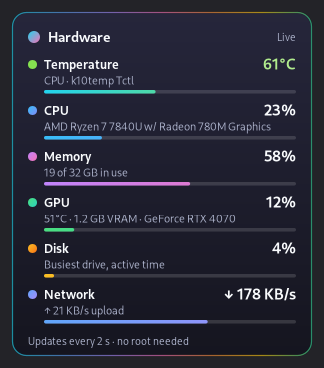

# HW Widget

[](https://github.com/Solarity-AI/hw-widget/actions/workflows/ci.yml)
[](https://github.com/Solarity-AI/hw-widget/releases/latest)
[](LICENSE)


A small, colorful hardware pill for the Windows taskbar, the GNOME top bar and the macOS menu bar.
It shows the **temperature**, the 3 metrics that matter most (**CPU**, **memory** and **GPU**, or disk when there is no GPU) and your live **download speed**.
Open it for details: GPU temperature and memory, disk activity and upload speed.

- Built from source on your machine with the compiler your OS already has.
- **No admin or root rights**, no background service, no downloads at install time.
- **No network access and no telemetry:** the code makes no network calls. The download speed is read from your network adapters' byte counters, not from a speed test.


| Windows card (dark) | Windows card (light) | GNOME card |
| --- | --- | --- |
|  |  |  |

## What it shows

| Cell | Source (no admin or root rights needed, except the opt-in Windows CPU temperature helper) | Turns amber / red at |
| --- | --- | --- |
| **TEMP** | CPU package temperature; GPU temperature (labelled `GPU°`) when the CPU has no readable sensor | 80 / 90 °C |
| **CPU** | Total processor load | 75 / 90 % |
| **RAM** | Memory in use | 80 / 90 % |
| **GPU** | Busiest graphics adapter; **DISK** (busiest drive's active time) when there is no GPU | 85 / 95 % (disk 80 / 95 %) |
| **DOWN** | Live download rate of your physical network adapters (Wi-Fi, Ethernet), local network traffic included, in KB/s, MB/s or GB/s: `178K`, `4.2M`, `46M` | Never; the bar fills on a log scale up to 1 Gbit/s |

Temperatures are in **°C** by default; switch to °F in the menu.
Turn the download cell off with **Show download speed** in the same menu.
The colour is judged on the whole number shown, so `75%` CPU is always amber.
An unknown value shows a dim dash instead of a guess.

## Install

Get the code first: [download the latest release](https://github.com/Solarity-AI/hw-widget/releases/latest) and unzip it, or clone the repository.

### Windows 10 and 11

Double-click `Install HW Widget (Windows).cmd`.

It compiles the widget with the C# compiler built into Windows straight into `%LOCALAPPDATA%\Programs\HW Widget` (no SDK, no PowerShell, no downloads, no admin rights). If Windows or an antivirus refuses that folder, it builds into `windows\bin` inside the repository folder instead; then keep that folder where it is, because the Startup shortcut points into it. The widget then runs its self-test, adds a shortcut to your Startup folder and starts.
Updating is the same: run the installer again. The new build is compiled first, so a failed build leaves the running widget alone.

Started from a terminal inside a Store app (for example the Claude desktop app), the installer would only reach that app's private copy of your user folders, so the widget would vanish when the app closes and never start at sign-in. The installer notices this and runs the install through a one-time Task Scheduler task instead, then deletes the task. `--check-sandbox` only reports which case applies.

Antivirus: older versions installed through a PowerShell script, a registry Run key and an automatic admin step, which Bitdefender's Advanced Threat Defense flagged as a dropper. The installer no longer does any of that, but the exe is still unsigned and built on your PC, so an antivirus can still block it. If yours does, add an exception for the repository folder and run the installer again: it falls back to building there.
The pill sits on the taskbar left of the tray. Hover for the details card, click to pin it, right-click for settings.

Sensors: Windows performance counters for CPU, memory and disk; the `GPU Engine` counters for GPU load, as Task Manager computes it; the graphics kernel (D3DKMT) for GPU names and temperature, with NVIDIA NVML as a fallback; ACPI thermal zones for the CPU temperature; and [LibreHardwareMonitor](https://github.com/LibreHardwareMonitor/LibreHardwareMonitor) or OpenHardwareMonitor when one is running.
It uses under 1 % of 1 core and about 35 MB of memory, and hides itself while a full-screen app (a game, a video) is in front; a maximized window doesn't hide it.

#### No CPU temperature? Enable the helper (1 admin prompt)

Some laptops, for example Intel Core Ultra (Lunar Lake) machines, show a dash for TEMP. Their only ACPI zone is a fixed placeholder, and the real sensors (Intel Dynamic Tuning, `root\wmi:EsifDeviceInformation`) can only be read by an admin.

To fix it, right-click the pill and choose **Enable CPU temperature (admin)**. You can also run this in a terminal in the repository folder:

```powershell
& '.\Install HW Widget (Windows).cmd' --cpu-temp
```

After 1 UAC prompt, this does 3 things:

1. It copies the widget to `%ProgramFiles%\HWWidget\HWWidgetSensor.exe`, a folder only admins can write to.
2. It registers the `HW Widget CPU temperature helper` task, which runs as SYSTEM at boot.
3. Every 2 seconds the task writes the hottest live reading to `%ProgramData%\HWWidget\cpu-temp.txt`. Users can read that folder but not write to it.

The widget itself still runs without admin rights. It ignores readings older than 15 seconds.

Turn the helper off from the same menu, which then reads **Remove CPU temperature helper (admin)**. `Uninstall HW Widget (Windows).cmd` also removes it.
Reinstalling the widget doesn't update an installed helper: remove it and enable it again from the menu to get the new version.

### Linux (GNOME Shell 42–49)

```bash
sh linux/install.sh
```

Log out and back in once if the script asks you to.
On GNOME 42–44 (for example Ubuntu 22.04) the script converts the extension to GNOME's older module format with `linux/legacy/convert.js`; it needs nothing extra.
On a GNOME newer than 49 the script stops with a clear message, since GNOME Shell refuses an extension that doesn't list its version.

Sensors: `/proc` for CPU, memory, disk and network (physical network adapters only, so bridges, bonds and VPNs aren't counted twice); `hwmon` and thermal zones for temperatures (Intel `coretemp`, AMD `k10temp` with the die temperature `Tdie` preferred over the fan-control `Tctl`, ARM `cpu-thermal`); `nvidia-smi` for NVIDIA GPUs, restarted if it exits; and `amdgpu` sysfs for AMD GPUs.
On laptops whose NVIDIA GPU can sleep, the widget never wakes it: a sleeping GPU shows 0 % ("asleep" in the card), and an awake one is read at most every 30 s, only after it has been awake on its own for 25 s.
Settings are saved in `~/.config/hwwidget/settings.json`.

### macOS 13 or later

```bash
./macos/install.sh
```

It needs the Command Line Tools (`xcode-select --install`), builds `HW Widget.app` into `~/Applications`, starts it and adds it to login items.

If the menu bar is too full for the whole pill (on a notched MacBook, the room right of the notch), the pill drops cells from the right (download, GPU, RAM, then CPU) instead of being moved into macOS's hidden menu bar items, and grows back when room opens up. The details card always shows every metric.

Sensors: Mach host statistics (CPU, memory), IOKit (GPU load and memory, disk activity per drive), the Apple Silicon thermal sensors or the Intel SMC for temperatures, and macOS's thermal state as a fallback.
Settings are saved in `~/Library/Application Support/HW Widget/settings.json`.

## Uninstall

Each command removes the widget, its startup entry and its settings. Run it from the repository folder.

| Platform | Command |
| --- | --- |
| Windows | Double-click `Uninstall HW Widget (Windows).cmd` (1 admin prompt only if the CPU temperature helper is installed) |
| Linux | `sh linux/uninstall.sh` |
| macOS | `./macos/uninstall.sh` |

## Troubleshooting

| Problem | What to do |
| --- | --- |
| TEMP shows a dash on Windows | Enable the CPU temperature helper (above), or run LibreHardwareMonitor. |
| TEMP shows `GPU°` | The CPU has no readable sensor, so the GPU temperature is shown instead. |
| The pill doesn't appear on GNOME | Log out and back in once; then check `gnome-extensions info hwwidget@solarity.ai`. |
| The Windows pill disappeared | A full-screen app is in front; it comes back when you leave full screen. |
| Something else | [Open an issue](https://github.com/Solarity-AI/hw-widget/issues/new) with your OS, hardware and what the pill shows. |

## Develop and test

| Platform | Command | What it checks |
| --- | --- | --- |
| Windows | `windows\build.cmd`, then `windows\bin\HWWidget.exe --selftest out.txt` | 48 sensor, helper, install, layout, formatting, full-screen and accessibility checks |
| Windows | `windows\tests\scripts-test.ps1` | 8 build, install and uninstall checks (folder names with brackets, spaces, parentheses and `&`; a fresh self-test report; the Startup shortcut) |
| Windows | `HWWidget.exe --render <dir>` / `--probe <secs> <csv>` | PNG renders of every state / live sensor log |
| Linux | `sh linux/tests/run-docker.sh` | 80 parser, sensor-tree, nvidia-smi and model checks, 15 GNOME 42 module checks and 16 install and uninstall checks, in Docker on Debian trixie (GNOME 45+) and Ubuntu 22.04 (GNOME 42), plus PNG renders in `linux/tests/out` |
| macOS | `sh macos/tests/run-docker.sh` | 63 model, parser, settings and menu-bar fit checks of the shared core, on Linux in Docker |
| macOS | `HWWidget --self-test`, `--probe 10`, `--render <dir>` | The same checks, a live sensor log and PNG renders, on a Mac |

CI runs all 3 platforms on pull requests and on manual runs, each only when its folder changes.

## Status

| Platform | Verified |
| --- | --- |
| Windows 11 | Running daily on a real laptop (Intel i7, NVIDIA Quadro): readings match Task Manager and `nvidia-smi` |
| Linux / GNOME | Tested in Docker; the GNOME 42 build loads, draws and survives 5 disable/enable cycles in a headless GNOME Shell 42.9 on a real laptop (Intel Core, NVIDIA RTX 4000 Ada); not yet seen in a live desktop session |
| macOS | Builds, self-test, live probe and renders pass on GitHub's macOS runner (a VM without temperature sensors); not yet run on a physical Mac |

Reports from real GNOME and Mac machines are welcome as [issues](https://github.com/Solarity-AI/hw-widget/issues).
Report security problems privately through [GitHub security advisories](https://github.com/Solarity-AI/hw-widget/security/advisories/new).

## License

© Solarity AI LLC. All rights reserved. See [LICENSE](LICENSE).
